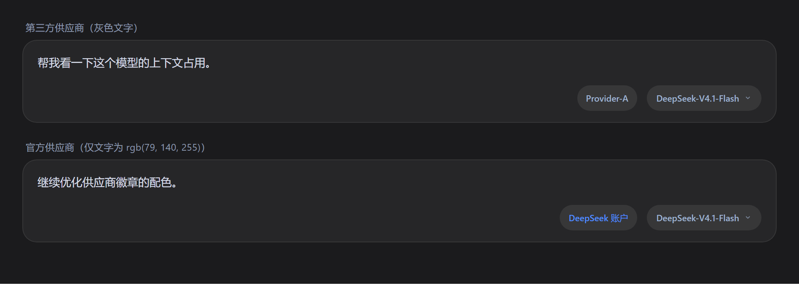

# dsh-provider-badge

在 DeepSeek Harness 输入框右下角、**模型胶囊左侧**显示当前供应商名称的灰色胶囊徽章。



纯客户端插件：不改任何 `@deepseek-ai/dsh-*` 源码，不注入页面内容 DOM，不做 MutationObserver。

## 它解决什么

DSH 的模型胶囊只显示模型名（`DeepSeek-V4.1-Flash`）和推理强度，看不到这条请求实际走的是哪个供应商（`Provider-A` / `Provider-B` …）。本插件在胶囊旁边补一个只读的供应商徽章，悬停可看到「供应商 · 模型」全名。

## 为什么挂在 `conversation.input.right`

官方输入框的控件行（构建产物已核对）：

```tsx
<div className={css.standardControls}>
  {renderSlot('conversation.input.right', {})}
  {renderSlot('conversation.input.model', { locked })}
</div>
```

`.standardControls` 是 `display:flex; align-items:center; gap:12px`。插件以 `order: 1000` 注册进 `conversation.input.right`（当前 slot 里常见条目都更小），自然落在模型胶囊左侧；再用 `margin-right: -6px` 把间距收成 6px，视觉上读作一组。`order` 是相对位置而非绝对保证——若其它插件注册了更大的 order，会插到徽章与胶囊之间。

**关键**：官方提供的 `conversation.input.model.label` 是「胶囊内部」的内联标签插槽，只有官方 `ModelSelect` 声明了它的 `children`。当前环境里 `dsh-reasoning-effort` 用 `priority: -1` 顶掉了官方座位，它的 `ReasoningBar` 不渲染这个插槽——所以徽章必须挂在座位**外面**，才能对官方/第三方两种胶囊都成立。

## 数据来源

`ctx.modelDirectories.directoryFor(sessionId).store` —— 与模型胶囊同一个 per-session 目录快照：

- `state.pending`（已提交、待生效的选择）优先，其次 `state.current`（已生效选择）；
- `state.groups.find(g => g.id === provider).name` 是本地化显示名（Host 侧 `displayName ?? provider id`）；
- 目录尚未加载时回退到 provider id，加载完成后自动替换；
- 无选择、子代理会话或目录不可用时**整枚隐藏**，不占位、不报错。

> 模型菜单里「点选但尚未关闭菜单」的暂存选择属于该菜单组件自己的本地状态（例如
> `dsh-reasoning-effort` 的 `pendingModel`），共享目录中不存在，因此插件边界内无法感知；
> 关闭菜单触发 `directory.select()` 后，`state.pending` 立即可见，徽章会立刻跟随。
> 若菜单一直开着、只是悬停/暂存，徽章仍显示已生效的供应商——这也正是此刻请求实际使用的路由。

组件挂载时会调用 `directory.load()` 刷新目录（与官方模型菜单同一份 per-session 目录，内部是 `session.models` 读取，不会额外访问外部网络）；目录错误由模型菜单自己呈现。

### 冷启动重试

会话刚建立时，`modelDirectories.directoryFor(sessionId)` 可能先抛
`cannot get property "remote.session" without inject`（`ModelDirectoryResolver`
自己的依赖还没注入完成）。因此 `inject` 返回 `resolve()`，组件挂载后每 250ms 重试、最多 40 次（约 10 秒）；若窗口内未就绪，页面从隐藏恢复可见（`visibilitychange`）时会自动重新武装一轮，避免一次性放弃后永久缺徽章。

`package.json` 的 `dsh.client.inject` 声明的是**客户端模块到达顺序**（包级信息性依赖，不是 Cordis 服务注入）；真正的服务激活门槛是 `client.js` 的
`exports.inject = ['slots', 'modelDirectories', 'locale']`：缺少任一服务时插件整体不激活，输入框不受影响。

## 本地化

- 插件自己的唯一文案 `account`（目录尚未加载时的 DeepSeek 账户名）通过
  `ctx.locale.register('dsh-provider-badge', { zh, en })` 注册，并把 `locale` 席位放到
  slot 注册项上；语言切换时 slot 内文案实时更新，不依赖 `document.documentElement.lang`。
- 供应商名、模型名本身来自 Host 的 per-session 目录，已经是本地化显示名。

## 样式

- 高度默认 32px，与常见模型 trigger 同形（999 圆角、11px/17px、500 字重）；
  换回官方 28px 胶囊时可在任意祖先元素设置 `--dsh-provider-badge-height: 28px`；
- 普通第三方供应商：底色 `--dsw-alias-interactive-bg-hover`、文字 `--dsw-alias-label-secondary`，全部语义 token，深浅主题自动适配；不写死任何颜色；
- **官方供应商仅文字用亮蓝**：`deepseek-account`（DeepSeek Account）与
  `deepseek-official`（DeepSeek）的文字色固定为用户指定的 `rgb(79, 140, 255)`
  （不随主题变化）；胶囊形状与底色和其它供应商完全一致，不变；
  其余供应商保持灰色文字；
- `border-radius:999px` 与 `corner-shape:round` 配对，符合主题对 full-round 形状的要求；
- 最大宽度 168px，超长名称省略号；`title` 提供「供应商 · 模型」完整信息。

## 安装

### 推荐：Plugin Manager（bundle 安装）

本包是合法的 dsh bundle（`package.json` 的 `dsh.bundle.patch` 指向
`cordis.patch.yml`）。在 DSH 会话里用 `plugin_manager`：

```
action: install_bundle
target: <本目录的绝对路径，例如 D:\plugins\dsh-provider-badge>
```

安装完成后重启 DSH。之后升级/卸载都走 Plugin Manager，无需手工改 profile。

**从旧的手工安装迁移**：

1. `pwsh -NoProfile -File .\install.ps1 -Uninstall`（移除旧 junction、profile patch 条目与 `link:` 依赖）；
2. 用上面的 `install_bundle` 安装；
3. 重启 DSH。

> 不要在同一个 profile 里同时保留「手工 insert」和「bundle 安装」：两条路径会重复注册同一个 id。

### 传统脚本（本地开发 / 旧版宿主）

```powershell
pwsh -NoProfile -File .\install.ps1
```

脚本会：

1. 把本目录 Junction 到 `~/.dsh/profiles/<profile>/node_modules/dsh-provider-badge`
   （只建这一处；旧版共享布局可加 `-LegacyShared` 同时建到 `profiles/node_modules`）；
2. 在 profile 的 `cordis.patch.yml` 追加一段 `insert`（改前自动备份、写后校验、失败回滚，备份保留最近 5 份）；
3. 从 profile 目录校验 `require.resolve` 能解析到包。

创建 Junction 失败时脚本直接报错，不再静默复制成一份不会更新的副本。

脚本执行前会先检查 profile 是否已把本包列入 `dsh.profile.bundles`（即已用
Plugin Manager 作为 bundle 安装）：若是则拒绝手工注册，避免同 id 双注册。

卸载（`-Uninstall`）会尽量做全：即使 patch 条目形态无法自动处理而报错，也会继续清理
Junction 与 profile `package.json` 的 `link:` 依赖，不会留下半卸载状态。

## 卸载

```powershell
pwsh -NoProfile -File .\install.ps1 -Uninstall
```

会移除：`cordis.patch.yml` 里的 insert 条目、指向本目录的 Junction、
profile `package.json` 里的 `link:` 依赖（均自动备份）。然后重启 DSH。

若使用 Plugin Manager 安装，则用 `plugin_manager remove_bundle` 卸载后重启。

## 兼容性

- 模型胶囊无论是官方 `ModelSelect` 还是第三方覆盖（如 `dsh-reasoning-effort`），徽章位置都成立；
- 依赖客户端服务 `slots` / `modelDirectories` / `locale`：缺少任一（例如禁用 `ui-model-selection` 或 `client-locale`）时插件整体不激活，输入框不受影响；
- 不使用任何 `@deepseek-ai/*` 运行时依赖，只 `require('react')`；
- 与其他 `conversation.input.right` 条目共存（按 `order` 排序）；
- 高度默认 32px，可用 `--dsh-provider-badge-height` 适配不同胶囊高度。

## 开发

```powershell
npm run check   # node --check
npm test        # node --test：vm + React 桩，覆盖注册/locale/名称解析/渲染/样式/重试
npm run test:sandbox  # 受限沙箱内使用 --test-isolation=none（需 Node >= 22.8）
```

> 在 DSH 自带的 pwsh 沙箱里，`npm test` 会因为 Node test runner 用管道 stdio 派生子进程而报
> `spawn EPERM`；这是沙箱限制，不是测试失败。改用 `npm run test:sandbox`，或在普通终端里跑
> `npm test`。`tests/package.test.mjs` 另外校验 bundle 声明、`exports`/`files`、locale 元数据、图标与
> `cordis.patch.yml`，防止元数据回退。`preview/` 下的 PNG 是设计预览，不参与运行时。

## 版本

- **0.1.0**：首版，挂在 `conversation.input.right`；
- **0.1.1**：修复冷启动竞态（失败不再缓存成永久 `null`），补重试与依赖边；
- **0.2.0**：改为合法 bundle（`dsh.bundle.patch`）；补 `locale` 字典与图标/展示元数据；
  移除本地调试上报通道；`install.ps1` 重写为单 junction、失败即停、可 `-Uninstall`
  （支持共享 insert 块、检测 bundle 双注册、卸载容错）；高度改用
  `--dsh-provider-badge-height` 变量；补冷启动重试与打包元数据测试；
  修复重试窗口结束后迟到的 store 被忽略、uSES subscribe 身份抖动、共享 insert 块误判等问题。
- **0.2.1**：选择提交期间优先显示 `state.pending`，徽章在菜单关闭提交后立即跟随新供应商，
  不再等 Host 持久化完成；菜单内尚未提交的暂存选择属于菜单组件本地状态，跨插件无法感知。
- **0.2.2**：官方供应商（`deepseek-account` / `deepseek-official`）徽章单独使用 DeepSeek 蓝
  （`--dsw-alias-state-business-primary` + 同色浅底），第三方供应商保持灰色。
- **0.2.3**：按反馈收敛为**仅文字变色**：官方供应商只把文字改为 DeepSeek 蓝，
  胶囊形状与底色与其它供应商完全一致。
- **0.2.4**：按反馈把官方供应商文字色固定为用户指定的亮蓝 `rgb(79, 140, 255)`
  （不随主题变化）；胶囊形状与底色仍保持不变。
